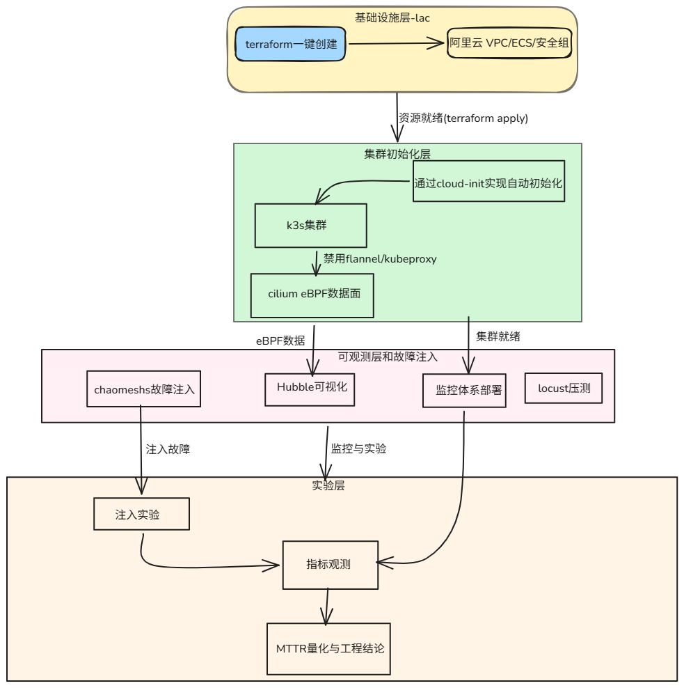

# K8s-Cilium-SRE-Platform

K3s + Cilium 云原生网络 SRE 平台 | Terraform + Cloud-init + Cilium eBPF + Chaos Mesh

---

## 项目简介

基于阿里云的云原生网络 SRE 实验平台。用 **Terraform + Cloud-init** 一键部署 K3s 集群，
禁用 flannel 与 kube-proxy，由 **Cilium eBPF** 完全接管网络数据面。

通过 **3 个混沌工程实验**，量化了 DNS 故障、网络延迟、CNI Agent 故障的
**爆炸半径**与 **MTTR**。

---

## 项目架构

### 系统架构图


### 核心设计决策

- **K3s（轻量、启动快）替代标准 K8s**
- **Cilium eBPF 替代 Flannel**（O(1) Service 转发 + L7 可观测）
- **禁用 kube-proxy**，完全交由 Cilium 接管
- **Cloud-init 全自动初始化**，`terraform apply` 即就绪

---

## 3 个 SRE 实验

### 实验一：CoreDNS 故障爆炸半径

| 探针 | OK | FAIL |
|---|---|---|
| DOMAIN（走域名） | 230 | 113 |
| CLUSTERIP（直连） | 342 | **0** |

> **结论**：DNS 故障是"发现层"故障，不是"连接层"故障。ClusterIP 直连完全不受影响。

### 实验二：网络延迟对吞吐量的影响

| 指标 | 基线 | 注入 500ms | 恢复后 |
|---|---|---|---|
| RPS | 490.5 | **138.3** | 493.5 |
| P99 | 19ms | 550ms | 13ms |

> **结论**：吞吐量崩塌 72%，P99 放大系数仅 1.06。验证 **Little's Law**——延迟的核心伤害是吞吐量下降。

### 实验三：Cilium Agent 故障

| 观测项 | 结果 |
|---|---|
| 探针（数据面） | 全程 OK |
| Agent 自愈 | 17 秒 |
| 新 Pod 创建 | 2 秒成功 |

> **结论**：控制面与数据面解耦。Agent 挂了，内核里的 eBPF Map 还在正常转发。

---

## 快速开始

### 前置准备

- 阿里云账号 + AccessKey
- Terraform 1.5+
- SSH 密钥对

### 一键部署

```bash
cd terraform
terraform init
cp terraform.tfvars.example terraform.tfvars   # 填阿里云 AK
terraform apply                                # 约 8 分钟
ssh root@$(terraform output -raw public_ip)
```

### 跑实验

```bash
kubectl apply -f experiments/exp1-coredns/
kubectl apply -f experiments/exp2-network-delay/
kubectl apply -f experiments/exp3-cilium-agent/
```

---

## 目录结构

```
K8s-Cilium-SRE-Platform/
├── README.md
├── terraform/
│   ├── main.tf
│   ├── variables.tf
│   ├── outputs.tf
│   ├── terraform.tfvars.example
│   ├── .gitignore
│   └── cloud-init/
│       ├── setup.yaml
│       └── setup.yaml.example
├── experiments/
│   ├── exp1-coredns/
│   │   ├── 01-nginx-deployment.yaml
│   │   ├── 02-probe-domain.yaml
│   │   ├── 03-probe-clusterip.yaml
│   │   └── README.md
│   ├── exp2-network-delay/
│   │   ├── 01-demo-app.yaml
│   │   ├── 02-locust-script.yaml
│   │   ├── 03-locust-deployment.yaml
│   │   ├── 04-network-delay.yaml
│   │   └── README.md
│   └── exp3-cilium-agent/
│       ├── 01-probe-exp3.yaml
│       ├── 02-test-new-pod.yaml
│       └── README.md
└── screenshots/
    ├── cluster-setup/
    ├── monitoring/
    ├── exp1-coredns/
    ├── exp2-network-delay/
    └── exp3-cilium-agent/
```

---

## 6 个工程难点

| # | 难点 | 解法 |
|---|---|---|
| 1 | CNI 切换 CoreDNS 503 竞态 | sleep 30 + 重启 CoreDNS |
| 2 | 阿里云 NAT 回环 | kubeconfig 内部用 127.0.0.1 |
| 3 | 国内镜像拉取超时 | 多层换源 + ACR + ctr 重打 tag |
| 4 | Terraform templatefile 变量冲突 | 占位符 + sed 替换 |
| 5 | ACR OCI Chart 403 | 改用 OSS 存 Chart |
| 6 | 2C8G 资源博弈 | 精简组件 + 限制 resources |

---

## 技术栈

| 层 | 技术 | 版本 |
|---|---|---|
| IaC | Terraform + alicloud | ~> 1.200 |
| K8s | K3s | v1.30.1 |
| CNI | Cilium | 1.15.1 |
| 监控 | kube-prometheus-stack | 88.4.0 |
| 混沌 | Chaos Mesh | 2.8.4 |
| 压测 | Locust | 2.20.0 |

---

## 项目局限

- **单节点集群**：未验证多节点 VXLAN 收敛
- **CiliumNetworkPolicy**：遇到 Cilium 1.15.1 与 K3s 的 enforcement 兼容问题
- **按量付费**：实验完成后销毁集群，不常驻运行
- **单集群**：未做多集群管理

---

# 已知问题 & 后续计划

## CiliumNetworkPolicy enforcement 模式兼容问题

### 问题描述

在 Cilium 1.15.1 + K3s 环境中，配置 `policyEnforcementMode=always` 后，已存在 endpoint 的 BPF 程序不会自动重算。

### 尝试过的解法

| # | 方法 | 结果 |
|---|---|---|
| 1 | 修改 ConfigMap → Agent 重启 | ❌ 无效 |
| 2 | `cilium-dbg endpoint regenerate --all` | ❌ 无效 |
| 3 | 删除并重建 Pod | ❌ 仍然 Disabled |

### 推测原因

Cilium 1.15.1 与 K3s 的兼容性问题，或需要在首次安装 Cilium 时就显式指定 enforcement 模式，运行时修改不会触发 endpoint 的 BPF 程序重编译。

### 后续计划

| 方案 | 描述 | 优先级 |
|---|---|---|
| 方案 A | 重装 Cilium 并显式指定 `policyEnforcementMode=always` | 高 |
| 方案 B | 升级 Cilium 到 1.15.5 或 1.16.x | 中 |
| 方案 C | 多节点环境验证（单节点可能有特殊行为） | 中 |

### 当前状态

三个混沌实验已完成，CiliumNetworkPolicy 零信任隔离验证作为后续扩展项。

---

## License

Apache License 2.0
