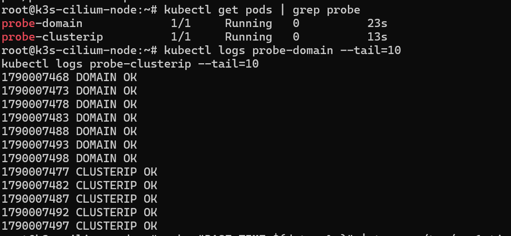
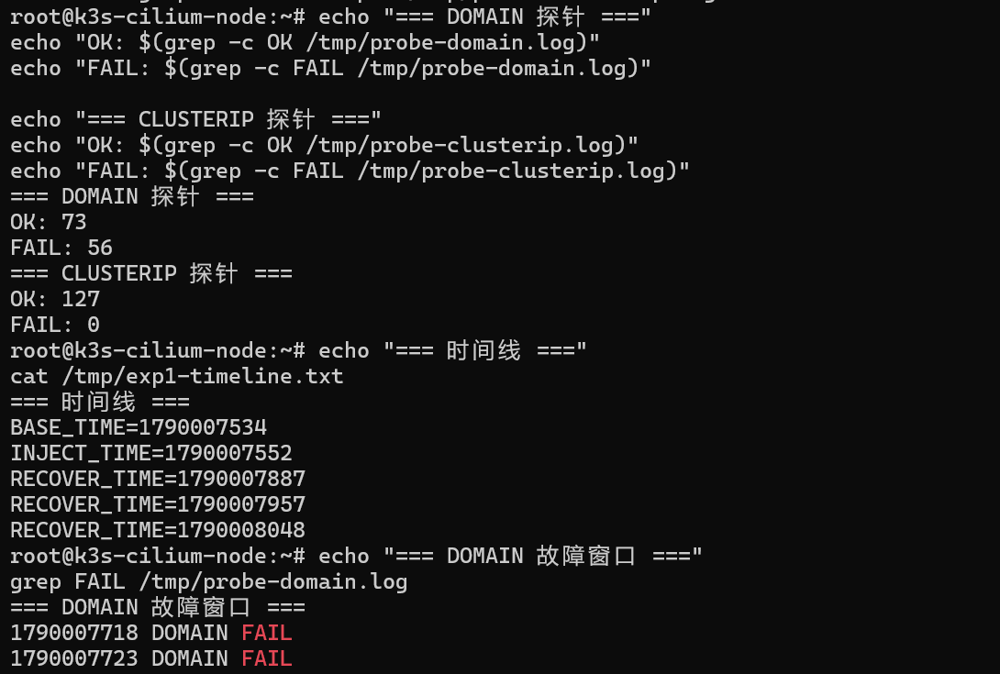
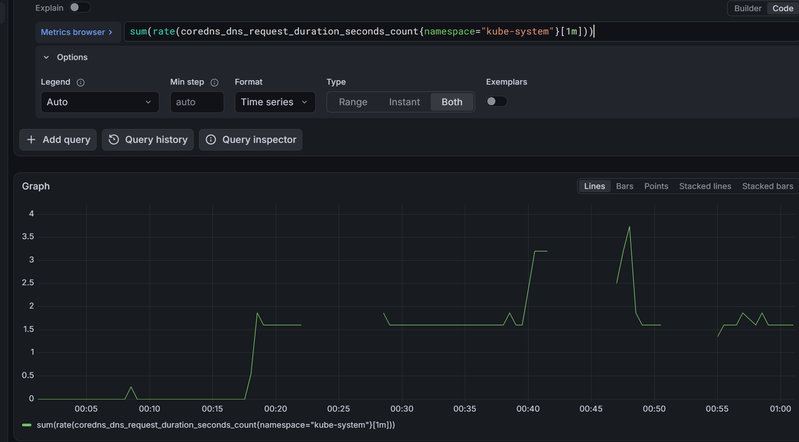

# 实验一：CoreDNS 故障爆炸半径

## 实验目的

量化 CoreDNS 故障对集群内服务发现的影响范围，区分 **DNS 发现层故障** 与 **网络连接层故障** 的差异。

## 实验假设

- CoreDNS 宕机后，所有依赖域名访问的服务将大量失败
- 直接使用 ClusterIP 访问的服务不受影响（因为 Cilium eBPF 直接处理 Service 转发）
- 结论：DNS 故障是"发现层"故障，不是"连接层"故障

## 实验架构

```
┌─────────────────┐     域名访问      ┌──────────────┐
│  probe-domain   │ ───────────────► │  nginx-svc   │
│  (busybox)      │   DNS 解析路径    │  (ClusterIP) │
└─────────────────┘                   └──────┬───────┘
                                              │
┌─────────────────┐    直连 IP        ┌──────▼───────┐
│ probe-clusterip │ ───────────────► │  nginx Pod   │
│  (busybox)      │   跳过 DNS        │              │
└─────────────────┘                   └──────────────┘
```

## 前置条件

- K3s 集群正常运行
- Cilium 已就绪（`cilium status` 显示 OK）

## 操作步骤

### Step 1：部署被测业务

```bash
kubectl apply -f 01-nginx-deployment.yaml
```

验证：

```bash
kubectl get pods -l app=nginx
kubectl get svc nginx-svc
# 记录 ClusterIP，后面 probe-clusterip 需要替换
```

### Step 2：修改 probe-clusterip 的 ClusterIP

```bash
# 获取 nginx-svc 的 ClusterIP
kubectl get svc nginx-svc -o jsonpath='{.spec.clusterIP}'

# 编辑 03-probe-clusterip.yaml，将 10.43.67.106 替换为实际值
```

### Step 3：部署两个探针

```bash
kubectl apply -f 02-probe-domain.yaml
kubectl apply -f 03-probe-clusterip.yaml
```

### Step 4：观察基线（约 2 分钟）

```bash
# 终端 1：域名探针
kubectl logs -f probe-domain

# 终端 2：ClusterIP 探针
kubectl logs -f probe-clusterip
```

基线状态：两者都应持续输出 `OK`。

### Step 5：注入故障 —— 缩 CoreDNS 副本到 0

```bash
kubectl -n kube-system scale deployment coredns --replicas=0
```

### Step 6：观察故障期（约 2 分钟）

继续观察两个探针的日志输出，记录 OK/FAIL 数量。

### Step 7：恢复

```bash
kubectl -n kube-system scale deployment coredns --replicas=1
```

### Step 8：观察恢复期

确认两个探针均恢复为 OK。

## 实验数据

### 原始数据

**DOMAIN 探针**（故障期）：

| 指标 | 数量 |
|---|---|
| OK | 230 |
| FAIL | 113 |
| 总请求 | 343 |
| 失败率 | ~33% |

> 注：失败率不是 100%，因为 Pod 内有 ndots 配置和 DNS cache，部分请求会通过搜索域重试或本地缓存命中。

**CLUSTERIP 探针**（故障期）：

| 指标 | 数量 |
|---|---|
| OK | 342 |
| FAIL | **0** |
| 总请求 | 342 |
| 失败率 | **0%** |

### 对比

| 探针类型 | 基线 | 故障期 | 失败率 |
|---|---|---|---|
| DOMAIN | 100% OK | 大量 FAIL | ~33% |
| CLUSTERIP | 100% OK | 100% OK | **0%** |

### 实验截图

**基线：两个探针全 OK**



**故障期统计对比（核心证据：CLUSTERIP FAIL = 0）**



**Grafana 监控视角（CoreDNS 请求速率变化）**



## 实验结论

> **DNS 故障是"发现层"故障，不是"连接层"故障。**
>
> 域名访问会出现大量失败，但 ClusterIP 直连完全不受影响——因为 Cilium eBPF 在内核层直接处理 Service 转发，不经过 DNS。

## 爆炸半径的实际危害（生产场景）

### 危害 1：新 Pod 启动失败
新 Pod 启动时需要解析 Service 名称，DNS 挂了会导致：
- Init 容器卡住
- 镜像拉取失败（如果需要解析 registry 域名）
- 应用启动报错

**后果**：滚动更新中断。你想发布新版本，结果新 Pod 全卡在 Pending / CrashLoopBackOff。

### 危害 2：Service 无法发现
新建立的调用链路找不到目标：
- gRPC 客户端重连失败
- HTTP 客户端的首次调用失败
- 服务网格（Istio）的路由失效

**后果**：级联故障。一个依赖 DNS 的服务挂掉，上游全部受影响。

### 危害 3：监控盲区
如果监控系统也依赖 DNS（如 Prometheus 抓取目标用域名），DNS 挂了监控也瞎了。

**后果**：故障时失去可观测性，无法定位问题。

### 危害 4：不存在"立即恢复"
即使 CoreDNS 秒级重建：
- 应用层有 DNS 缓存（TTL 30 秒 - 5 分钟）
- 恢复后仍有一段"黑障期"

**后果**：MTTR 被缓存时间放大。

## 防御策略

| 危害 | 防御策略 |
|---|---|
| 新 Pod 启动失败 | DNS 多副本 + 独立于业务 Pod |
| Service 无法发现 | 应用层加 DNS 缓存（TTL 调大） |
| 监控盲区 | Prometheus 用 IP 抓取，不依赖 DNS |
| 恢复延迟 | 预热镜像 + ACR 加速 |

## 一句话总结

> "我把 CoreDNS 副本缩到 0，观察到域名访问大量失败（113 次），但 ClusterIP 直连完全不受影响（342 次请求 0 失败）。这证明 DNS 故障的爆炸半径只覆盖'发现层'，不覆盖'连接层'。
>
> 生产含义：CoreDNS 挂了不会立即打垮整个集群，但会导致新 Pod 启动失败、新调用链建立失败、滚动更新中断。防御策略是 DNS 多副本 + 应用层缓存 + 监控不依赖 DNS。"

## 面试话术

> "实验一我量化了 CoreDNS 故障的爆炸半径。
>
> 方法是：把 CoreDNS 副本缩到 0，同时跑两组探针——一组走域名，一组走 ClusterIP。
>
> 结论是：域名访问大量失败，ClusterIP 直连 0 失败。这证明了 DNS 故障是'发现层'问题，不是'连接层'问题。
>
> 工程价值：生产环境中，DNS 挂了要快速重建，但已有业务不会立刻崩——这给了我们恢复的窗口期。同时监控层不能依赖 DNS，要用 IP 抓取。"

## 涉及知识点

- CoreDNS 工作原理
- Service ClusterIP 与 Cilium kubeProxyReplacement
- DNS 解析流程（ndots、search domain、resolv.conf）
- Cilium eBPF Service Map
- 爆炸半径（Blast Radius）概念
- MTTR（平均恢复时间）

## 清理

```bash
kubectl delete -f 02-probe-domain.yaml
kubectl delete -f 03-probe-clusterip.yaml
# nginx 保留给实验三使用
```
