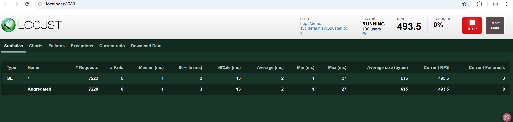
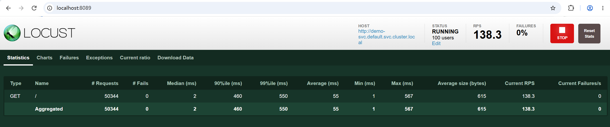

# 实验二：网络延迟对吞吐量的影响

## 实验目的

通过 Chaos Mesh 注入网络延迟，量化延迟对系统吞吐量（RPS）和延迟分布（P99）的影响，验证 **Little's Law** 在实际系统中的表现。

## 背景与假设

**背景**：云上跨可用区抖动、宿主机网卡问题，生产中表现为"某个依赖变慢"。

**假设**：下游延迟 +500ms → P99 增幅大于 500ms（队列/重试放大）

## 实验环境

- K3s v1.30.1 + Cilium 1.15.1，单节点
- 被测服务：nginx:1.27（demo-app）
- 压测工具：Locust，100 用户
- 注入：Chaos Mesh NetworkChaos delay 500ms + jitter 50ms
- 时长：120 秒

## 实验架构

```
┌──────────────┐    HTTP 请求     ┌──────────────┐
│   Locust     │ ───────────────► │   demo-app   │
│  (压测端)    │                  │   (nginx)    │
│  100 用户    │ ◄─────────────── │              │
└──────────────┘    响应          └──────┬───────┘
                                        │
                                        │ Chaos Mesh
                                        │ NetworkChaos
                                        ▼
                                 500ms + 50ms jitter
```

## 前置条件

- K3s 集群正常运行
- Cilium 已就绪
- **Chaos Mesh 已安装**（`kubectl get pods -n chaos-mesh`）

## 操作步骤

### Step 1：部署被测业务

```bash
kubectl apply -f 01-demo-app.yaml
```

验证：

```bash
kubectl get pods -l app=demo-app
kubectl get svc demo-svc
```

### Step 2：部署 Locust 压测端

```bash
kubectl apply -f 02-locust-script.yaml
kubectl apply -f 03-locust-deployment.yaml
```

### Step 3：访问 Locust UI

通过 NodePort 或 port-forward 访问：

```bash
kubectl port-forward svc/locust-svc 8089:8089
```

浏览器打开 `http://localhost:8089`。

### Step 4：基线压测（3~5 分钟）

在 Locust UI 中设置：

- Number of users: **100**
- Spawn rate: **10**
- Host: `http://demo-svc.default.svc.cluster.local`

点击 Start swarming，等待数据稳定后记录 RPS 和 P99。

### Step 5：注入网络延迟

```bash
kubectl apply -f 04-network-delay.yaml
```

验证注入生效：

```bash
kubectl get networkchaos delay-demo-2
# STATUS 应为 Running
```

### Step 6：观察故障期（2~3 分钟）

在 Locust UI 中观察 RPS 和延迟的变化，记录稳定后的数据。

> 注意：NetworkChaos 的 `duration: "120s"` 表示 120 秒后自动恢复。如果需要更长观察时间，可以修改 duration 或重新 apply。

### Step 7：观察恢复

等待自动恢复，或手动清理：

```bash
kubectl delete -f 04-network-delay.yaml
```

记录恢复后的 RPS 和延迟数据。

## 注入操作时间线

| 时刻 | 事件 |
|---|---|
| T0 | 基线稳定：RPS 490.5，P99 19ms |
| T1 | kubectl apply network-delay.yaml |
| T1+120s | Chaos 自动解除 |

## 观测数据

| 指标 | 基线 | 注入中 | 恢复后 |
|---|---|---|---|
| **RPS** | 490.5 | **138.3** | 493.5 |
| P50 (ms) | 1 | 2 | 1 |
| P90 (ms) | 3 | 460 | 3 |
| **P99 (ms)** | 19 | **550** | 13 |
| 失败率 | 0% | 0% | 0% |

### 实验截图

**基线：RPS 493.5，P99 13ms**



**注入 500ms 延迟：RPS 暴跌到 138.3，P99 550ms**



**Chaos Mesh NetworkChaos 注入操作**


## 实验结论

**假设不成立**：
- P99 放大系数 = **1.06**（几乎无延迟放大）
- **但吞吐量崩塌 72%**

**真正的发现**：
> **延迟注入的核心影响是吞吐量崩塌，不是延迟放大。**
>
> 验证 Little's Law：L = λW（系统中平均请求数 = 到达率 × 平均等待时间）

### Little's Law 验证

系统中并发用户数 L = 100（Locust 用户数）

```
基线:  λ = RPS = 490.5,  W ≈ P50 = 1ms
       λ × W = 490.5 × 0.001 = 0.49  ← 系统中平均在途请求数

故障期: λ = 138.3,  W ≈ P90 = 460ms
       λ × W = 138.3 × 0.460 = 63.6  ← 接近 100 用户上限
```

当延迟增加时，系统中"在途请求"数量增加，很快触达并发用户上限，导致吞吐量下降。

## 工程启示

- 容量规划不能只看延迟，要看"延迟-QPS 曲线"
- 单点 500ms 延迟就能让系统吞吐量下降 72%
- 生产环境要监控 RPS 曲线，而非仅看 P99
- 100 用户并发下单节点接近饱和，多加并发可能触发 OOM

### 延伸思考

1. **为什么延迟几乎线性叠加，没有级联放大？**
   - 被测服务是简单的 nginx 静态页面，没有下游依赖
   - 如果是微服务链路（A→B→C），延迟会逐级放大

2. **生产环境中网络延迟的影响？**
   - 跨地域调用的延迟直接限制了最大吞吐量
   - 超时设置不合理会导致重试风暴
   - 可以通过增加并发数（连接池）缓解，但有上限

3. **和 CPU 打满、内存不足等故障的区别？**
   - 网络延迟：延迟升高 + 吞吐量下降 + 错误率可能不变
   - CPU 打满：延迟升高 + 吞吐量下降 + 错误率升高（超时）
   - 内存不足：OOM kill + 服务重启 + 可用性下降

## 涉及知识点

- Chaos Mesh NetworkChaos
- Little's Law（排队论基础）
- 延迟分布（P50 / P90 / P95 / P99）
- 吞吐量 vs 延迟的权衡
- tc（Linux Traffic Control）底层原理
- MTTR / 爆炸半径

## 清理

```bash
kubectl delete -f 04-network-delay.yaml
kubectl delete -f 03-locust-deployment.yaml
kubectl delete -f 02-locust-script.yaml
kubectl delete -f 01-demo-app.yaml
```
