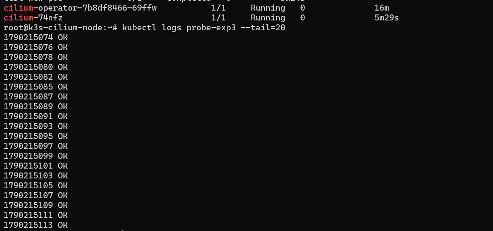
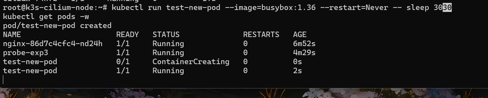

# 实验三：Cilium Agent 故障爆炸半径

## 实验目的

验证 Cilium Agent（控制面）故障时，eBPF 数据面是否仍然正常工作，量化 **控制面与数据面解耦** 的实际效果。

## 背景与假设

**背景**：Cilium 是集群 CNI 组件，以 DaemonSet 形式运行。问题是：Agent 挂掉后，集群网络会立即失效吗？

**假设**：
1. 已有 eBPF 程序继续工作（数据面残留）
2. 已有连接和已有 Service 不受影响
3. 新建 Pod / 新建 Service 会失能
4. DaemonSet 自愈，恢复时间在秒级

## 实验环境

- K3s v1.30.1 + Cilium 1.15.1，单节点
- 被测业务：nginx Deployment + nginx-svc
- 探针：probe-exp3（每 2 秒访问 nginx）
- 注入：`kubectl delete pod -l k8s-app=cilium`

## 实验架构

```
┌─────────────────────────────────────────────────┐
│                   Node                          │
│                                                 │
│  ┌───────────┐    eBPF Map (内核态)             │
│  │ Cilium    │    ┌────────────────────┐        │
│  │ Agent     │───►│ Service / Endpoint │        │
│  │ (用户态)  │    │ Policy / Route     │        │
│  └───────────┘    └─────────┬──────────┘        │
│                             │ 数据面残留         │
│  ┌───────────┐              │                   │
│  │  probe    │ ◄────────────┘                   │
│  │  (Pod)    │                                  │
│  └───────────┘                                  │
│                                                 │
└─────────────────────────────────────────────────┘

  Cilium Agent 故障 ──► eBPF Map 不变 ──► 数据面正常
```

## 前置条件

- K3s 集群正常运行
- Cilium 已就绪（`cilium status` 显示 OK）
- nginx deployment + service 已部署（实验一可复用）

## 操作步骤

### Step 1：确保被测业务运行

```bash
# 如果实验一的 nginx 还在，直接复用
kubectl get pods -l app=nginx
kubectl get svc nginx-svc

# 如果没有，从实验一目录部署
# kubectl apply -f ../exp1-coredns/01-nginx-deployment.yaml
```

### Step 2：部署探针

```bash
kubectl apply -f 01-probe-exp3.yaml
```

### Step 3：观察基线（约 1 分钟）

```bash
kubectl logs -f probe-exp3
```

基线状态：持续输出 `OK`。

### Step 4：注入故障 —— 删除 Cilium Agent Pod

```bash
kubectl -n kube-system delete pod -l k8s-app=cilium
```

> Cilium Agent 是以 DaemonSet 运行的，删除 Pod 后会自动重建。

### Step 5：观察三件事（并行）

**终端 1：观察探针（验证数据面残留）**

```bash
kubectl logs -f probe-exp3
```

**终端 2：观察 Agent 自愈过程**

```bash
kubectl -n kube-system get pods -l k8s-app=cilium -w
```

**终端 3：尝试创建新 Pod（验证 CNI 是否受影响）**

```bash
# 等 Agent 被删除后立即执行
kubectl apply -f 02-test-new-pod.yaml
kubectl get pods test-new-pod -w
```

### Step 6：记录数据

记录 Agent 自愈时间、探针是否中断、新 Pod 启动情况。

### Step 7：验证恢复

```bash
kubectl -n kube-system get pods -l k8s-app=cilium
```

## 注入操作时间线

| 时刻 | 事件 |
|---|---|
| T+0s | 删除 Cilium Agent Pod |
| T+12s | 新 Agent 创建（0/1 Running） |
| T+17s | Agent 就绪（1/1 Running） |
| T+30s | 测试新 Pod 创建 |
| T+32s | test-new-pod 1/1 Running |

## 观测数据

**探针**：全程 OK（数据面残留）

**Agent 自愈**：
- 创建到 Ready：**17 秒**

**新建 Pod**：
- test-new-pod：ContainerCreating → Running 2 秒
- 事件：Scheduled → Pulled → Created → Started，无异常

### 实验截图

**探针全程 OK（Cilium Agent 重启后，数据面无影响）**



**新 Pod 创建：ContainerCreating → Running 仅 2 秒**



## 假设验证

| 假设 | 结果 |
|---|---|
| 1. 数据面残留 | ✅ 成立 |
| 2. 已有 Service 继续工作 | ✅ 成立 |
| 3. 新建 Pod 失能 | ❌ **不成立** |
| 4. 17 秒自愈 | ✅ 成立 |

## 实验结论

> **单节点 K3s 环境下，Cilium Agent 故障的爆炸半径极小。**
>
> 已有的网络连接完全不受影响（数据面残留），Agent 自愈时间约 17 秒。新建 Pod 也能成功——原因是 Agent 自愈极快 + 镜像本地化。
>
> **注意：此结论不能外推到多节点集群。** 多节点环境下，Agent 故障可能影响跨节点通信（VXLAN/Geneve 隧道管理）、Endpoint 同步、NetworkPolicy 更新等。

## 工程启示

- CNI Agent 挂掉 ≠ 网络挂掉：数据面残留是保护机制
- **单节点结论不能外推到多节点**：跨节点 VXLAN 依赖 Agent
- 生产建议：
  - CNI 独立监控（Pod 状态 + eBPF Map 一致性）
  - 多节点环境需单独测试
  - 后续扩展：多节点 + ClusterMesh 验证

### 延伸思考

1. **为什么数据面能独立工作？**
   - Cilium 将所有转发规则、Service Map、Policy 都写入内核 eBPF Map
   - eBPF Map 是内核对象，生命周期不依赖用户态进程
   - Agent 只负责"写规则"，不负责"转发流量"

2. **多节点环境下 Agent 故障的影响？**
   - 同节点 Pod 通信：不受影响（本地 eBPF Map）
   - 跨节点 Pod 通信：可能受影响（隧道端点管理）
   - Service 转发：可能受影响（Endpoint 同步）
   - NetworkPolicy 更新：失效（新规则无法下发）
   - 新建 Pod：失败（CNI 插件需要 Agent）

3. **Cilium 控制面高可用？**
   - DaemonSet 保证每个节点一个 Agent
   - 节点级故障不影响其他节点
   - 可以通过 `cilium-operator` 高可用进一步提升

## 涉及知识点

- Cilium 架构（Agent / Operator / eBPF Datapath）
- 控制面 vs 数据面解耦
- eBPF Map 的生命周期
- DaemonSet 自愈机制
- CNI 插件工作流程
- 爆炸半径评估

## 清理

```bash
kubectl delete -f 01-probe-exp3.yaml
kubectl delete -f 02-test-new-pod.yaml
```

## 进阶实验建议

1. **多节点实验**：在多节点集群中重复此实验，观察跨节点通信是否受影响
2. **NetworkPolicy 实验**：在 Agent 故障期间创建 CiliumNetworkPolicy，观察是否生效
3. **长时间故障**：故意让 Agent 长时间不恢复，观察数据面是否有衰减
4. **Operator 故障**：删除 cilium-operator，观察对集群的影响
